<div align="center">

# 🍃 Leaflight

**让故事适合此刻的你 —— 本地优先的英日分级小说创作工坊、沉浸式仿真阅读器、科学 × 奇幻跨学科伴学与四维 AI 写作教练**

*A Local-First English (CEFR A2–C1) & Japanese (JLPT N5–N1) AI Fiction Studio, Tactile Graded Reader, Science × Fantasy Learning Companion, and 4D Writing Coach for macOS.*

[](https://github.com/jayson-sheyue/Leaflight/releases/tag/v0.11.9)
[-1d1d1f?style=for-the-badge&logo=apple)](https://github.com/jayson-sheyue/Leaflight/releases/tag/v0.11.9)
[](#5-本地优先隐私安全与非阻塞后台消息盒子)
[](#1-英日双语分级故事工坊-cefr-a2c1--jlpt-n5n1)

<br />

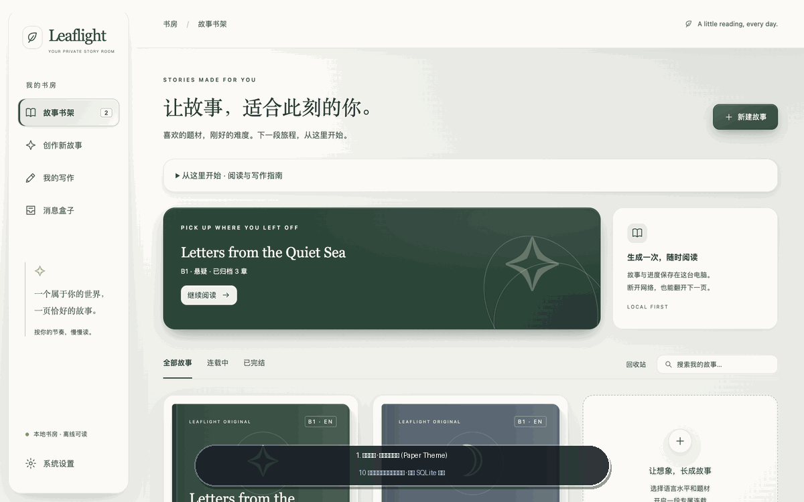

<p align="center">
  <sub>▲ <b>Leaflight 核心功能一镜预览</b>：暖纸与深海玻璃主题书架 → 三步式新建故事 → 科学 × 奇幻阅读预设 → 英/日仿真阅读器与假名注音 → 本地「科学手记」 → 独立写作台（图表渲染 + 四维 AI 批改） → 非阻塞后台消息盒子。图片展示基础流程；最新面板放大操作见下方说明。</sub>
</p>

</div>

---

## 🌟 为什么会有 Leaflight？（30 秒看懂项目定位）

许多外语学习者与跨学科读者都面临同一个痛点：
- **原版小说太难**，生词密集、长难句劝退，翻两页就变成了查词典苦旅；
- **传统分级读物太幼稚**，剧情单薄乏味，缺乏让人忍不住想翻下一页的连载张力；
- **阅读与写作长期割裂**，读完故事没有输出反馈，备考雅思（IELTS）、日本留学试验（EJU）或练习学术/创意写作时缺少针对性的逐句诊断。

**Leaflight（叶光书房）** 是一款运行在 macOS 本地桌面端的**私人外语故事书房与读写伴学工作站**。它将 **大语言模型结构化连载生成（Gemini Structured Output）**、**严谨的语言分级与启发式难度校验**、**英国教育部 DfE / 日本文部科学省 MEXT / NASA 真实科学课程知识库** 以及 **拟真电子书排版与四维写作批改** 融为一体：

| 核心场景 | Leaflight 提供的解决方案 |
| :--- | :--- |
| **📖 想读引人入胜、难度刚好的外语小说** | 支持 **英语（CEFR A2 / B1 / B2 / C1）** 与 **日语（JLPT N5 / N4 / N3 / N2 / N1）** 难度目标。自选悬疑、科幻、奇幻、冒险、日常、爱情 6 类题材，设置 1–100 章，通过人物设定、章节摘要与连续性记录辅助连载。 |
| **🔬 想在读小说中自然理解科学原理** | 内置 **24 个跨学段科学单元** 与 **48 个「科学 × 奇幻」故事预设**。把科学原理融入故事，并提供带来源链接的本地章节 **「科学手记」**；不等同于完整教材或事实正确性保证。 |
| **✍️ 想练就扎实的外语与科学写作能力** | 内置 **184 道英日原创写作练习**，涵盖学校学段、IELTS/EJU 题型训练及 **96 道科学写作任务**。提供 **语法 / 词汇 / 逻辑 / 通顺** 四维定性评审，题目回应与科学概念另列反馈，不提供官方考试评分。 |
| **🎨 追求安静、护眼、有质感的阅读体验** | 提供 **10 套全局材质主题**、**8 种翻页动效**、**12 套字体栈** 与 **中/日/英三语界面**；支持放大阅读、编辑或评审主面板并收起辅助面板。字体显示取决于本机可用字体。 |
| **🔒 重视本地隐私与流畅响应** | 故事、书签、阅读进度、写作草稿与评审历史保存在本地 `SQLite`；API Key 经 Electron `safeStorage` 加密后保存。生成与评审会向 Google Gemini 发送相关文本，后台执行时可继续阅读。 |

---

## ✨ 核心亮点与界面展示

### 1. 英日双语分级故事工坊（CEFR A2–C1 & JLPT N5–N1）

- **三步式向导创作**：仅需选择「语言与等级」→「题材或科学融合预设」→「篇幅与主角设定」，即可开启专属连载。
- **同情节难度对照**：入口为左侧「创作新故事」→ 展开「篇幅与更多选项 · 可保持默认」→「同情节难度对照」。输入同一场景并选择两个等级（如 `A2 vs C1`、`N5 vs N1`），使用自己的 Gemini Key 发起一次联网生成，可能产生 API 费用；最近一次结果保存在本机，可离线查看。模型返回的情节一致性和难度差异仍需人工核对。
- **难度约束与复核**：生成提示包含分级词汇和句法目标，本地启发式分析复核句长、用词和日语汉字等指标，并显示偏差提示；不自动重复调用模型修正，也不代表官方等级认证。
- **读后体感校准**：每章读完可一键反馈「偏难 / 刚好 / 偏轻松」，下一章自动微调句式复杂度。

<table>
  <tr>
    <td width="50%">
      
      <p align="center"><sub><b>三步式创作工坊</b>：清晰选择语言、分级、题材与章节规模</sub></p>
    </td>
    <td width="50%">
      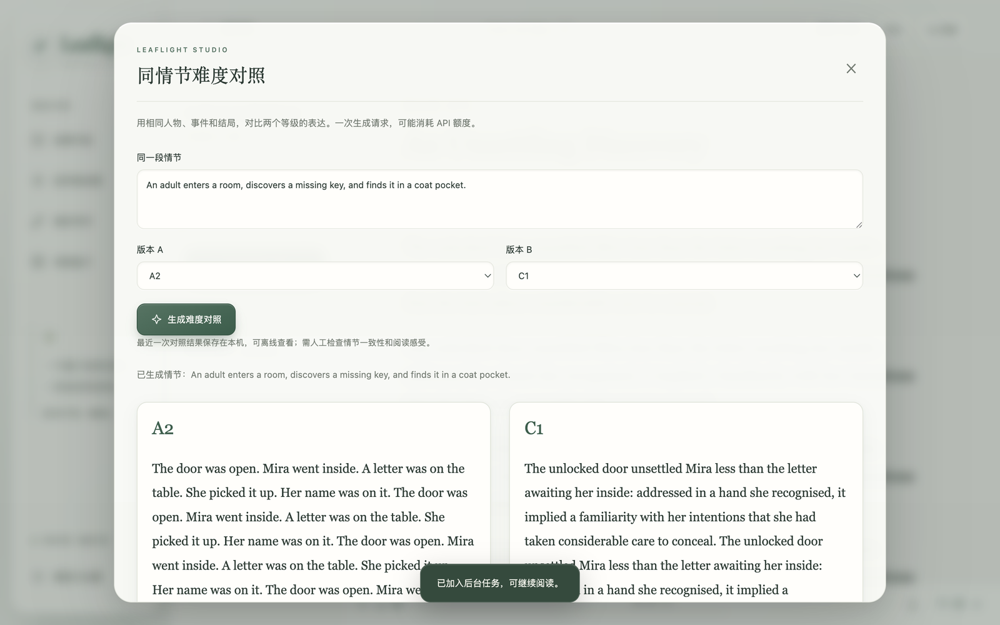
      <p align="center"><sub><b>同情节难度对照界面</b>：截图使用自动测试的模拟响应，仅展示布局与交互；其中重复文本不是实际 Gemini 生成效果，也不是内置的离线对照材料。</sub></p>
    </td>
  </tr>
</table>

---

### 2. 拟真翻页阅读器与 10 套全局材质主题

- **8 种拟真翻页动效**：支持 `Paper Curl（仿真卷页）`、`Cube In（内立方翻转）`、`Cube Out（外立方翻转）`、`Carousel（旋转木马）`、`Flip（中轴对折）`、`Bounce（弹性回跃）`、`Slide（平滑推页）` 与 `Fade（呼吸淡入）`。
- **自适应阅读与面板放大**：支持滚动与分页模式、字号、行距和正文宽度设置。点击「放大阅读区」后，导航缩为图标栏、目录收起；「恢复布局」或 Esc 返回，并保留当前阅读文字位置。
- **日语振假名注音（Furigana）**：针对 JLPT `N5–N3` 章节自动渲染标准 `<ruby>漢字<rt>かんじ</rt></ruby>` 假名注音，并在正文下方提炼核心语法句型。
- **书签可添加也可取消**：书签按钮为开／关状态；目录中每条书签右侧「×」可直接删除，兼容旧记录和同页重复书签。

<div align="center">
  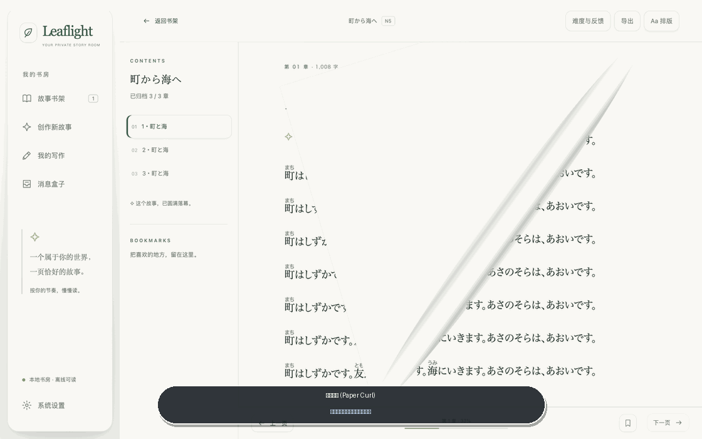
  <p align="center"><sub>▲ <b>8 种仿真翻页动效 & 10 套全局材质主题</b>（Paper / Rose / Mist / Sand / Bamboo 纸感 + Ocean / Violet / Dusk / Jade / Night 玻璃拟态）</sub></p>
</div>

<table>
  <tr>
    <td width="50%">
      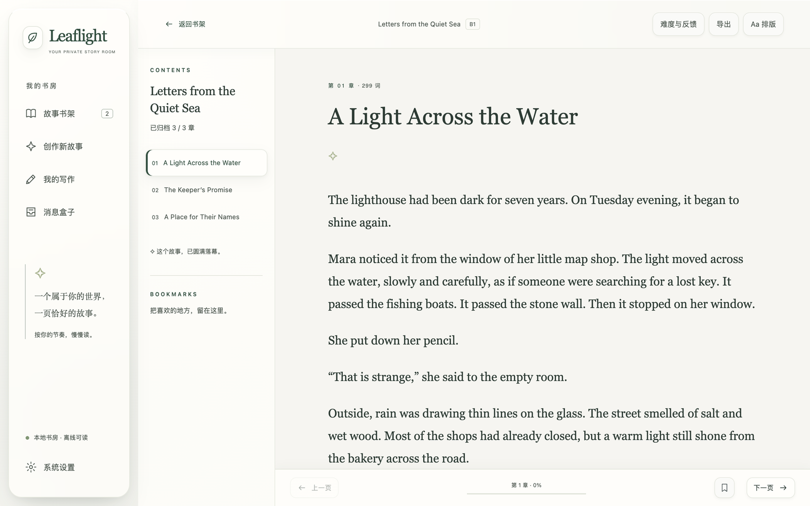
      <p align="center"><sub><b>英语沉浸式阅读器</b>：目录抽屉、字号/行距调节与页码进度</sub></p>
    </td>
    <td width="50%">
      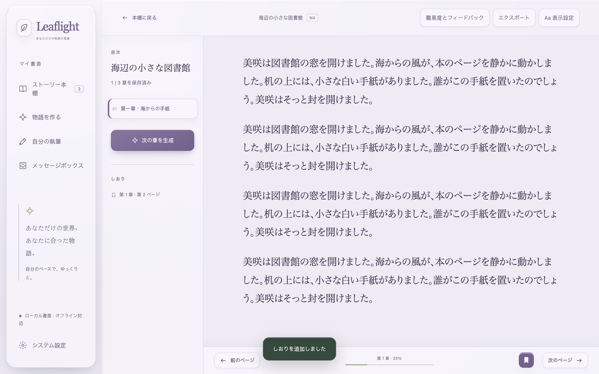
      <p align="center"><sub><b>日语阅读与三语 UI</b>：支持 N5–N3 汉字振假名与语法要点解析</sub></p>
    </td>
  </tr>
  <tr>
    <td width="50%">
      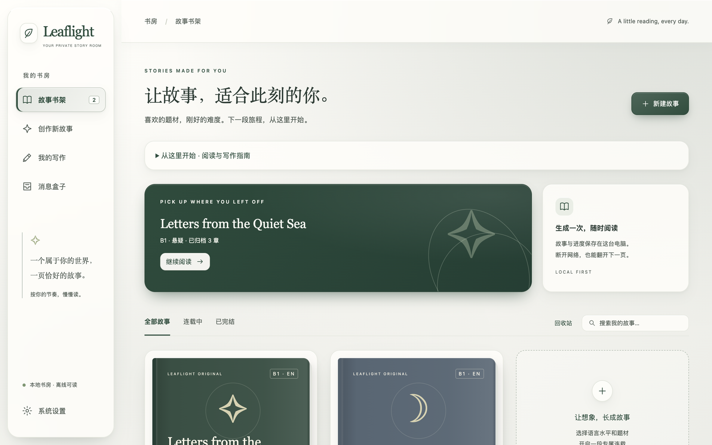
      <p align="center"><sub><b>暖纸护眼主题（Warm Paper）</b>：温润纸张肌理，适合长时阅读</sub></p>
    </td>
    <td width="50%">
      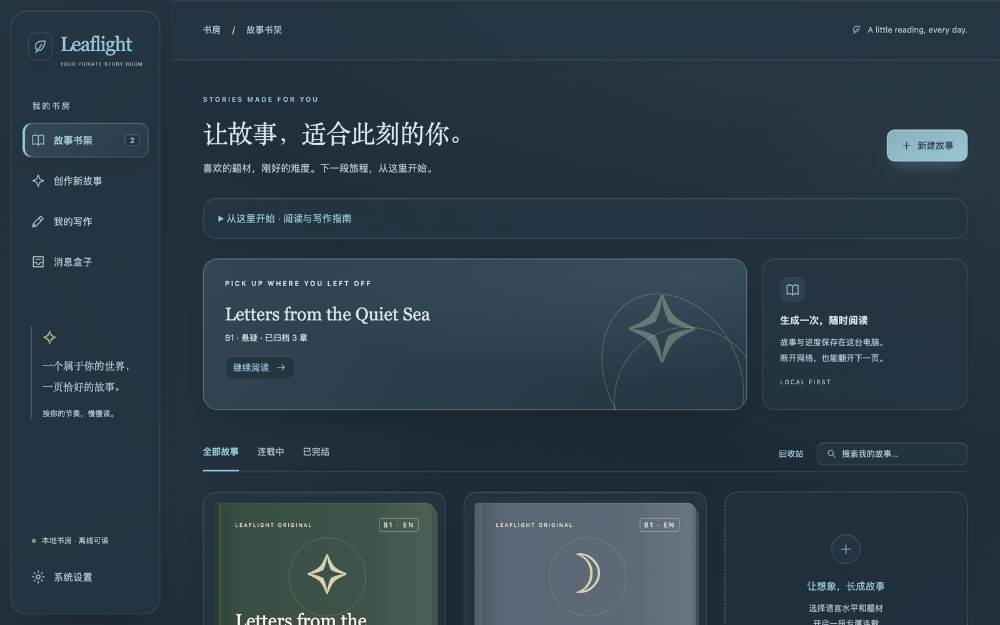
      <p align="center"><sub><b>深海冷光主题（Ocean Glass）</b>：高对比毛玻璃拟态，支持透光度调节</sub></p>
    </td>
  </tr>
</table>

---

### 3. 科学 × 奇幻主线融合与本地「科学手记」

Leaflight 独创了 **Science × Fantasy（科学 × 奇幻/科幻/悬疑）** 伴学模式，拒绝生硬说教，让科学原理成为主角破局的钥匙：

- **24 个跨学段真实科学单元**：覆盖 **小学（Primary）→ 初中（Middle）→ 高中（High）→ 大学通识（University）** 四大阶段，涵盖物理与工程、生物与医学、化学与材料、地球与空间四大领域。
- **48 个双语科学故事预设**：例如在《雾港钟楼的回声》中利用「声波反射与介质传播」破解密室回声，或在《深海发光实验室》中借助「生物荧光与酶催化」追踪失落样本。
- **本地「科学手记（Science Notebook）」**：核心原理、常见误区、自测与来源链接由本地结构化资料渲染，参考 [England National Curriculum DfE](https://www.gov.uk/government/collections/national-curriculum)、[日本文部科学省 MEXT 学習指導要領](https://www.mext.go.jp/a_menu/shotou/new-cs/index.htm)、[NASA Science](https://science.nasa.gov/)。它与模型生成的故事正文分开；资料与 AI 文本仍应结合来源核对。

<table>
  <tr>
    <td width="50%">
      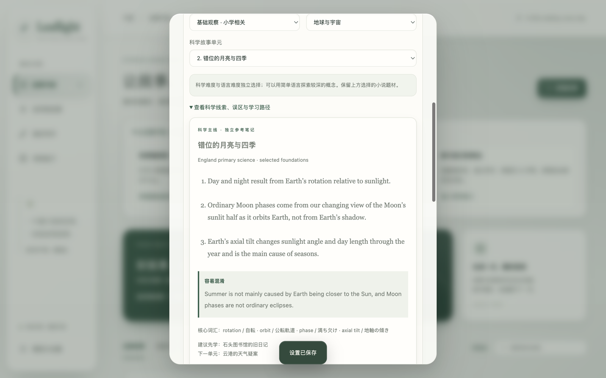
      <p align="center"><sub><b>科学 × 奇幻故事预设</b>：按学段与学科挑选感兴趣的科学解谜主线</sub></p>
    </td>
    <td width="50%">
      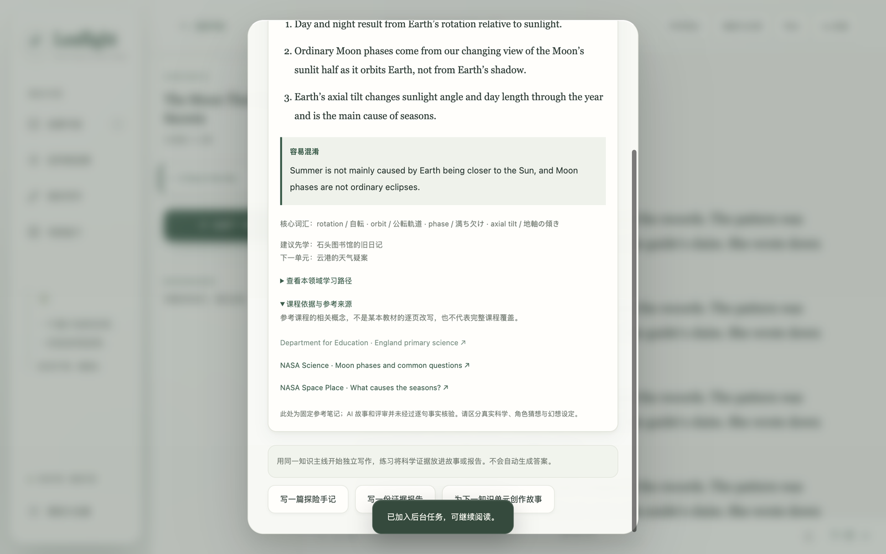
      <p align="center"><sub><b>章节「科学手记」</b>：原理拆解、误区纠偏与英/日/美官方课程权威来源</sub></p>
    </td>
  </tr>
</table>

---

### 4. 独立写作台与四维 AI 写作教练（184 道内置题库）

无需先读完小说，随时可进入左侧导航的 **「我的写作」** 开启针对性训练；也可以在读完任意故事章节后一键进入 **「读后感 / 故事续写 / 科学观察手记」**。

- **184 道原创练习题**（参考题型与课程主题，不是官方考题或教材摘录）：
  - **雅思题型训练（IELTS Academic Task 1 & Task 2）**：Task 1 内置**真实可视化柱状图、数据表与流程图组件**，完整还原图表作文审题场景；
  - **日本留学试验（EJU 日本語記述問題）**：贴合日本大学入试学术议论文要求；
  - **小学 → 初中 → 高中 → 大学进阶训练**：覆盖记叙、书信、议论与学术思辨；
  - **96 道科学写作专项任务**：围绕物理、化学、生物、地球与宇宙的 24 个知识单元，各提供概念解释和证据推理练习；题目提供参考知识、常见误区与思考提示，不要求虚构情节。历史草稿保留其原题。
- **四维 AI 批改与原文精确摘录验证**：
  - 从 **语法与拼写、词汇与用词、逻辑与衔接、通顺与表达** 四个维度提供定性反馈；有题目时另评任务回应，科学题另附概念反馈；
  - 逐句建议的原文摘录通过本地子串校验，不匹配的评审会报错；AI 判断和修改建议仍可能有误；
  - 「查看提交时的原文」和「查看完整修订参考稿」支持整行点击及 Enter／空格展开。编辑区与评审区可分别放大，草稿及评审展开状态保留；
  - 草稿自动保存在本机；删除会经确认永久移除正文、评审与相关任务，需保留的稿件可归档或先导出。

<table>
  <tr>
    <td width="50%">
      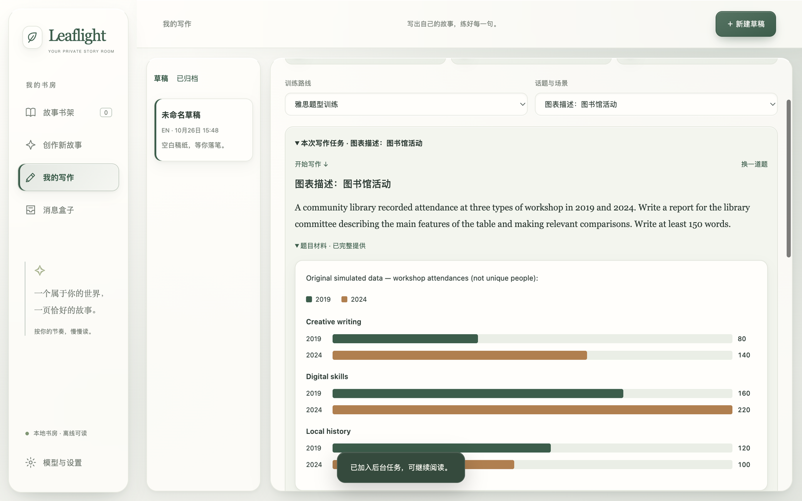
      <p align="center"><sub><b>IELTS 图表作文真实渲染</b>：内置可视化柱状图与流程材料，告别干瘪纯文本题干</sub></p>
    </td>
    <td width="50%">
      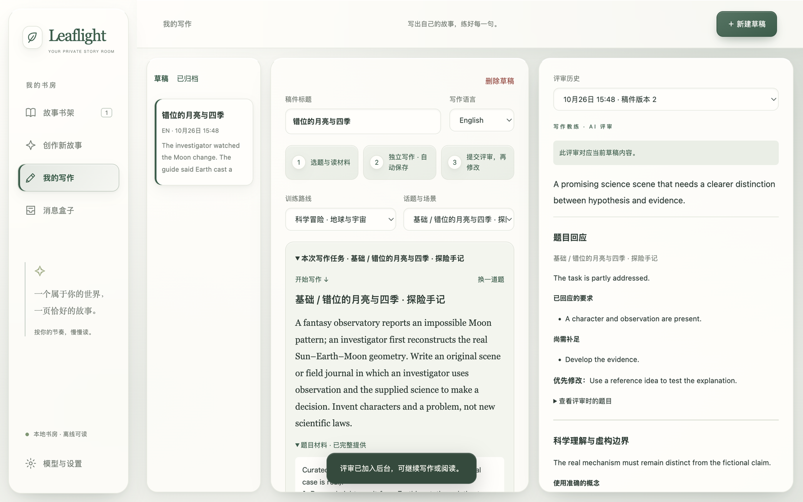
      <p align="center"><sub><b>AI 写作教练</b>：四维语言反馈、任务回应与科学概念反馈，以及原文对照润色</sub></p>
    </td>
  </tr>
</table>

---

### 5. 本地优先、隐私安全与非阻塞后台消息盒子

- **非阻塞后台任务队列（消息盒子）**：新建故事、续写下一章或提交长文批改时，任务自动进入后台运行。你可以随时回到书架继续阅读其他作品，完成后顶部胶囊与左侧「消息盒子」会实时通知并支持一键跳转。
- **离线示例**：无需 API Key 即可打开内置的三章英文故事 *The Lantern Keeper*，体验排版、翻页和书签，也可离线浏览写作题库；它是固定示例，不是按自定义提示生成的作品。
- **支持导出与备份**：支持将任意完结或连载中的故事导出为标准 **EPUB 3 电子书**（兼容 Apple Books / Kindle / Kobo）或 **TXT 纯文本**，并支持全库 JSON 一键备份与恢复。

<div align="center">
  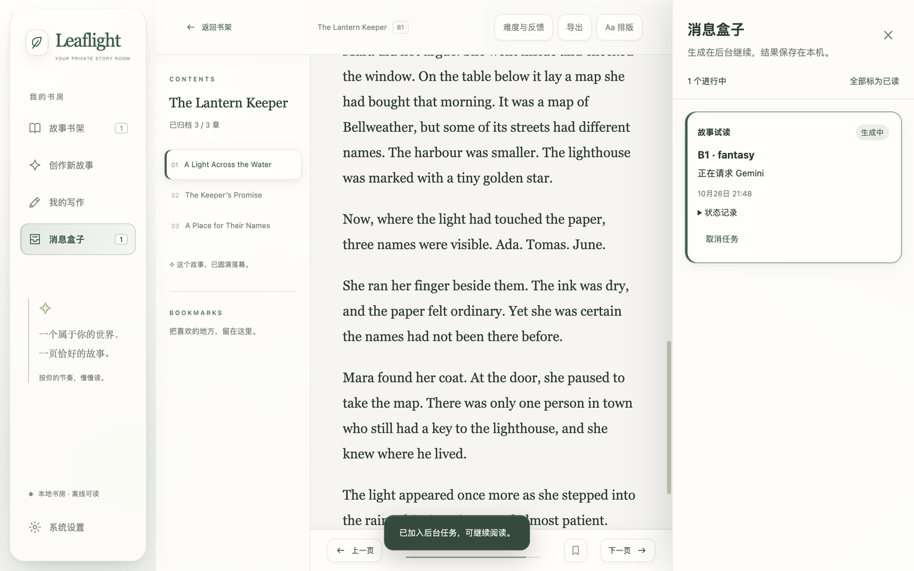
  <p align="center"><sub>▲ <b>非阻塞后台任务队列（消息盒子）</b>：AI 生成章节与批改在后台静默完成，阅读与写作零等待</sub></p>
</div>

---

## 📦 下载安装与快速上手

### 当前版本

Mac v0.11.9 将科学写作预设调整为客观学科知识的概念解释和证据分析；保留 TXT/EPUB 导入、扩充的英日题库与表达润色建议。详见 [v0.11.9 发布说明](docs/releases/v0.11.9.md)。

### Android Pad 阅读预览

独立的 **Leaflight Reader 0.2.1-preview.1** 安卓项目支持导入 Mac JSON 离线阅读，提供主题、字体、翻页、书签与进度。可导入 UTF-8 TXT、未加密 EPUB 或 JSON 备份；也可配置自己的 Gemini Key 生成英日独立短篇并离线阅读，生成状态在消息盒子中查看。两端进度暂不自动同步；安卓版暂不包含连载续写、写作与评审。Mac 与 Android 的构建和数据独立。[安装、构建与限制说明](android-reader/README.md)。 [下载 APK](https://github.com/jayson-sheyue/Leaflight/releases/tag/android-v0.2.1-preview.1)。

### 方式一：直接安装 macOS 桌面端（推荐）

1. 前往本仓库的 [**v0.11.9 Release**](https://github.com/jayson-sheyue/Leaflight/releases/tag/v0.11.9)，下载安装包：
   - 🍎 **`Leaflight-0.11.9-arm64.dmg`**（Apple Silicon Mac；不提供 Intel / Windows / Linux 安装包）
2. 双击打开 `.dmg`，将 **Leaflight.app** 拖入 `Applications（应用程序）` 文件夹。
3. 首次打开即可直接阅读内置示范故事；如需使用 AI 生成新章节或 AI 写作批改：
   - 点击左下角 **「系统设置 / 模型与设置」**；
   - 填写支持 `generateContent` 与 JSON 结构化输出的 **Gemini 模型 ID** 和 API Key，点击「保存设置」。已保存的 Key 以圆点显示；当前仅集成 Google 官方接口。

> **分发限制**：此包未做 Apple 开发者签名和公证，macOS 可能阻止打开；发布附件中的 SHA-256 仅用于检查下载完整性，不代替开发者签名。尚未完成干净系统安装与安全 OTA 验收。

**手动更新**：先在系统设置导出全库备份，等待后台任务完成并退出应用，再下载新版 DMG，将应用替换到原安装位置。不要删除 `~/Library/Application Support/novel-reading/` 用户数据目录。当前没有应用内检查更新或自动安装功能；详细变更与验证范围见 [v0.11.9 发布说明](docs/releases/v0.11.9.md)。

**配置与费用**：生成和 AI 评审需要联网及用户自己的 Gemini API Key，费用和额度取决于 Google 账户及所选模型。已归档作品与草稿可离线使用。接口与数据发送范围见 [API 集成说明](docs/api-references.md)。

---

### 方式二：从源码本地运行与构建

#### 环境要求
- **操作系统**：已在本机 Apple Silicon macOS 验证；包内最低系统声明为 macOS 12.0，最低版本系统尚未实机验证。
- **Node.js**：建议 `22.12+`，使用 `npm ci` 安装锁定依赖；运行打包应用无需另装 Node。

#### 启动开发环境
```bash
# 1. 克隆仓库
git clone https://github.com/jayson-sheyue/Leaflight.git
cd Leaflight

# 2. 安装依赖
npm ci

# 3. 启动桌面端热重载开发模式
npm run dev
```

#### 常用脚本与打包指令
```bash
# 类型检查与前端构建
npm run build

# 生成 macOS .app 与 .dmg 安装包（输出至 release/ 目录）
npm run package:dmg

# 单元测试与 15 项 Electron 桌面测试（使用隔离数据与受控模型响应）
npm test
npm run test:desktop
```

---

## 🏗️ 技术架构与工程设计

Leaflight 采用严格的进程隔离与本地优先架构，确保桌面端轻量、安全且易维护：

```text
Leaflight/
├── electron/
│   ├── main.cjs                # Electron 主进程：窗口生命周期、Keychain (safeStorage) 加密与安全 IPC 注册
│   ├── preload.cjs             # ContextBridge 白名单桥接（禁用 nodeIntegration）
│   ├── store.cjs               # 本地持久化存储、Schema 迁移、阅读锚点与回收站/JSON 备份
│   ├── gemini.cjs              # Gemini 原生 responseSchema 结构化输出 + 启发式难度复核与科学手记合并
│   ├── jobs.cjs                # 非阻塞后台任务队列（消息盒子）调度引擎
│   ├── science.cjs             # 24 个科学单元、48 个科学×奇幻预设与本地参考资料加载器
│   ├── writing.cjs             # 四维 AI 写作批改与原文精确摘录 (originalQuote) 校验
│   ├── writing-topics.cjs      # 184 道英日分级写作题库与 96 道科学写作专项任务引擎
│   ├── difficulty.cjs          # 英日分级约束（CEFR A2–C1 / JLPT N5–N1）与启发式复杂度检测
│   └── export.cjs              # 标准 EPUB 3 与 TXT 电子书打包导出器
├── src/
│   ├── main.ts                 # 应用主视图状态机、阅读器、创作工坊与后台消息盒子交互
│   ├── writing.ts              # 独立写作台、IELTS 可视化图表渲染与四维批改报告视图
│   ├── science.ts              # 科学×奇幻预设选择与章节「科学手记」抽屉组件
│   ├── materials.ts            # 10 套全局材质与毛玻璃主题、12 套字体栈控制器
│   ├── page-transitions.ts     # 8 种拟真 3D 翻页动效控制器与章节边界锚点保护
│   ├── panel-focus.ts          # 阅读/编辑/评审放大与布局恢复，不重建正文或编辑器
│   └── i18n.ts                 # 简体中文 / 日本語 / English 完整界面国际化字典
├── scripts/
│   └── create-dmg.cjs          # macOS Apple Silicon (.app & .dmg) 自动化打包脚本
└── tests/                      # Node.js 单元测试 + Playwright Electron 真实桌面端 E2E 测试套件
```

### 核心工程保障
1. **结构化输出与本地校验**：调用 Gemini 官方 `v1beta` REST `generateContent`，设置 JSON MIME 和 `responseSchema`，再校验规划、章节与评审字段；结构化约束不保证内容确定或事实正确。
2. **可读性检查**：测试覆盖 10 套主题的已渲染文字，受测状态达到对比度 `≥ 4.5:1`；这不是对全部 WCAG 条款的合规认证。
3. **桌面回归测试**：覆盖分级规则、题库、阅读与写作交互、后台任务、书签、面板放大及布局连续性；模拟模型响应不能代替真实服务联调。

---

## 📋 版本演进摘要（Changelog）

- **`v0.11.9`（当前版本）**：独立表达润色、184 道英日写作练习、客观科学写作、自备题目与 TXT/EPUB 导入；Android 预览版独立发布。[完整发布说明](docs/releases/v0.11.9.md)。
- **`v0.11.6`**：阅读、编辑和 AI 评审支持放大，辅助面板自动收起；恢复布局、翻页和重新打开作品时保留阅读文字位置。消息盒子以覆盖层展开，Esc 优先关闭弹窗或消息盒子。包含 v0.11.5 本地修复：评审原文／修订稿整行与键盘展开，旧书签及同页重复书签可取消，书签列表支持直接删除。[完整发布说明](docs/releases/v0.11.6.md)。
- **`v0.11.5`（仅本地开发构建）**：评审展开与书签取消修复，随 v0.11.6 一并发布。
- **`v0.11.4`（首个 GitHub Release）**：包含科学 × 奇幻阅读预设、本地科学手记、科学写作任务及概念反馈。
- **`v0.11.3`**：新增 **非阻塞后台任务队列（消息盒子）**、IELTS 图表题真实可视化渲染、同剧情跨级难度对比预览与读后难度体感校准。
- **`v0.11.1` – `v0.11.2`**：重构 **10 套全局材质与毛玻璃主题系统**、**8 种翻页动效**、**12 套字体栈** 与 **中/日/英三语 UI**，加入文字对比度检查。
- **`v0.10.0`**：新增 **日语分级阅读与写作支持（JLPT N5–N1）**、汉字 `<ruby>` 振假名注音与 EJU 日本留学试验写作训练。
- **`v0.1.0` – `v0.9.0`**：完成本地 SQLite + Keychain 基础架构、英语 CEFR A2–C1 多章连载记忆引擎、独立写作台与 EPUB 3 导出。

---

## 📄 开源协议 (License)

本项目基于 [MIT License](LICENSE) 开源。欢迎 Star ⭐、Fork 或提交 Issue 与 Pull Request！

### 单篇文件与完整备份

在 Mac 书架选择「导入 TXT / EPUB」，或在 Android 书架选择「导入 TXT / EPUB / 备份」。支持 UTF-8 TXT 与未加密的常见 EPUB（20 MB 文件、解压内容 8 MB 限制）；TXT 会按正文导入，EPUB 会读取文字章节和日语注音，原排版、图片、字体和部分复杂结构不保证保留。导入产生新副本，不会覆盖原书；难度不作判定。单篇 TXT/EPUB 不含书签、进度、草稿、AI 评审与生成设定，完整迁移仍请使用 JSON 备份。

题库的 184 道题均为原创训练材料，不是剑桥真题或教材原文；可在写作台的「自备题目或写作目标」中输入已有题目，自由写作时用于 AI 评审参考。IELTS 官方另提供[公开样题](https://ielts.org/take-a-test/preparation-resources/sample-test-questions/academic-test)。
