[English](README.md) · [日本語](README.ja.md) · [中文](README.zh-CN.md)

<div align="center">

# 🍃 Leaflight

**让故事适合此刻的你 —— 本地优先的英日分级小说创作工坊、沉浸式仿真阅读器、科学 × 奇幻跨学科伴学与四维 AI 写作教练**

*A Local-First English (CEFR A2–C1) & Japanese (JLPT N5–N1) AI Fiction Studio, Tactile Graded Reader, Science × Fantasy Learning Companion, and 4D Writing Coach for macOS.*

[](https://jayson-sheyue.github.io/Leaflight/)
[](https://github.com/jayson-sheyue/Leaflight/releases/tag/v0.12.2)
[-1d1d1f?style=for-the-badge&logo=apple)](https://github.com/jayson-sheyue/Leaflight/releases/tag/v0.12.2)
[](https://github.com/jayson-sheyue/Leaflight/releases/tag/android-v0.3.0-preview.7)
[](#5-本地优先共享书池免-key-读与分享与非阻塞后台消息盒子)
[](#1-英日双语分级故事工坊-cefr-a2c1--jlpt-n5n1)

<p align="center">
  👉 <b><a href="https://jayson-sheyue.github.io/Leaflight/">🌐 点击直接打开 GitHub Pages 在线网页预览版（免下载 · 免 API Key · 默认书架预置 6 部英日分级小说即点即读）</a></b> 👈
</p>

<br />

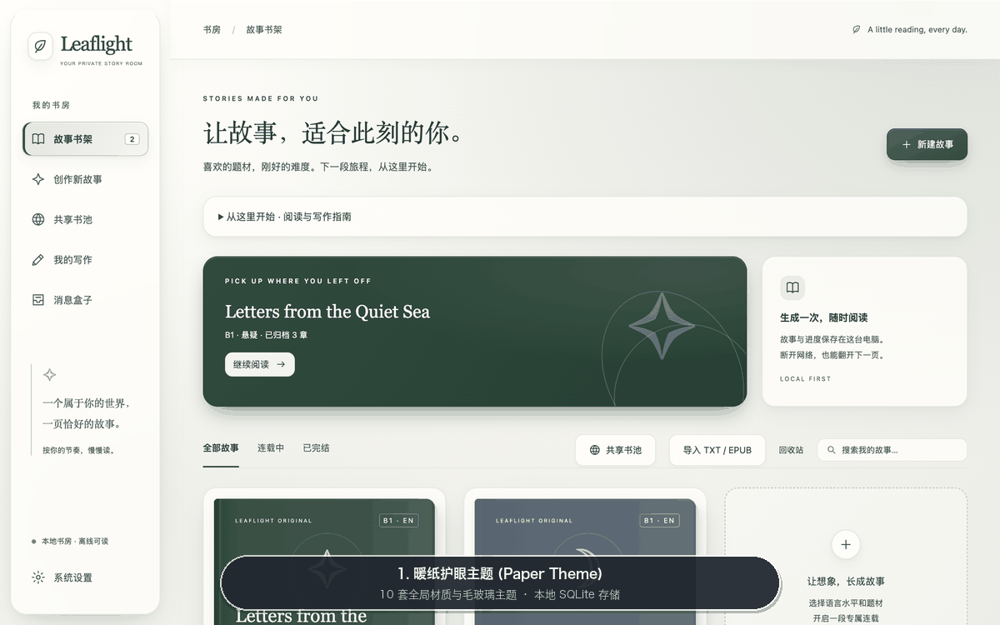

<p align="center">
  <sub>▲ <b>Leaflight 核心功能一镜预览</b>：暖纸与深海玻璃主题书架 → 共享书池（免 Key 借阅与分享） → 三步式新建故事 → 科学 × 奇幻阅读预设 → 英/日仿真阅读器与假名注音 → 本地「科学手记」 → 独立写作台（图表渲染 + 四维 AI 批改） → 非阻塞后台消息盒子。</sub>
</p>

</div>

---

## 🌟 为什么会有 Leaflight？（30 秒看懂项目定位）

许多外语学习者与跨学科读者都面临同一个痛点：
- **原版小说太难**，生词密集、长难句劝退，翻两页就变成了查词典苦旅；
- **传统分级读物太幼稚**，剧情单薄乏味，缺乏让人忍不住想翻下一页的连载张力；
- **阅读与写作长期割裂**，读完故事没有输出反馈，备考雅思（IELTS）、日本留学试验（EJU）或练习学术/创意写作时缺少针对性的逐句诊断。

**Leaflight（叶光书房）** 是一款运行在 macOS 本地桌面端的**私人外语故事书房与读写伴学工作站**。它将 **大语言模型结构化连载生成（Gemini Structured Output）**、**严谨的语言分级与启发式难度校验**、**英国教育部 DfE / 日本文部科学省 MEXT / NASA 真实科学课程知识库** 以及 **拟真电子书排版与四维写作批改** 融为一体：

| 核心场景 | Leaflight 提供的解决方案 |
| :--- | :--- |
| **📖 想读引人入胜、难度刚好的外语小说** | 支持 **英语（CEFR A2 / B1 / B2 / C1）** 与 **日语（JLPT N5 / N4 / N3 / N2 / N1）** 难度目标。自选悬疑、科幻、奇幻、冒险、日常、爱情 6 类题材，设置 1–100 章，通过人物设定、章节摘要与连续性记录辅助连载。 |
| **🌐 没有 API Key 也想读好故事 / 分享佳作** | 内置 **「共享书池（Community Story Pool）」**。无需配置 Gemini Key，即可直接浏览并从 GitHub 同步开发者与社区读者上传的免费英日分级小说（含日语振假名注音），一键加入书架离线阅读；生成了满意的小说也可在客户端一键脱敏分享至公共书池。 |
| **🔬 想在读小说中自然理解科学原理** | 内置 **24 个跨学段科学单元** 与 **48 个「科学 × 奇幻」故事预设**。把科学原理融入故事，并提供带来源链接的本地章节 **「科学手记」**；不等同于完整教材或事实正确性保证。 |
| **✍️ 想练就扎实的外语与科学写作能力** | 内置 **184 道英日原创写作练习**，涵盖学校学段、IELTS/EJU 题型训练及 **96 道科学写作任务**。提供 **语法 / 词汇 / 逻辑 / 通顺** 四维定性评审，题目回应与科学概念另列反馈，不提供官方考试评分。 |
| **🎨 追求安静、护眼、有质感的阅读体验** | 提供 **10 套全局材质主题**、**8 种翻页动效**、**12 套字体栈** 与 **中/日/英三语界面**；支持放大阅读、编辑或评审主面板并收起辅助面板。字体显示取决于本机可用字体。 |
| **🔒 重视本地隐私与流畅响应** | 故事、书签、阅读进度、写作草稿与评审历史保存在本地 `SQLite`；API Key 经 Electron `safeStorage` 加密后保存。生成与评审会向 Google Gemini 发送相关文本，后台执行时可继续阅读。 |

---

## ✨ 核心亮点与界面展示

### 1. 英日双语分级故事工坊（CEFR A2–C1 & JLPT N5–N1）

- **三步式向导创作**：仅需选择「语言与等级」→「题材或科学融合预设」→「篇幅与主角设定」，即可开启专属连载。
- **同情节难度对照（选级试读）**：用于创作前的一次短场景阅读体验，帮助你凭阅读感受手动选择目标难度；可按需重新试读。它不生成整部小说的两个难度版本，不认证用户语言等级，也不自动修改创作设置。入口为左侧「创作新故事」→ 展开「篇幅与更多选项 · 可保持默认」→「同情节难度对照」。每次体验用自己的 Gemini Key 发起一次联网请求，可能产生 API 费用；最近一次结果可离线回看。
- **难度约束与复核**：生成提示包含分级词汇和句法目标，本地启发式分析复核句长、用词和日语汉字等指标，并显示偏差提示；不自动重复调用模型修正，也不代表官方等级认证。
- **读后体感校准**：每章读完可一键反馈「偏难 / 刚好 / 偏轻松」，下一章自动微调句式复杂度。

<table>
  <tr>
    <td width="50%">
      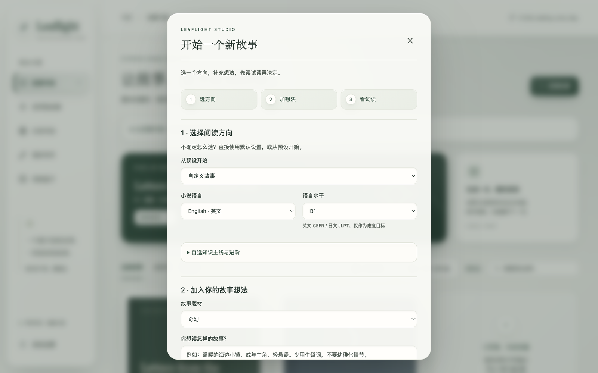
      <p align="center"><sub><b>三步式创作工坊</b>：清晰选择语言、分级、题材与章节规模</sub></p>
    </td>
    <td width="50%">
      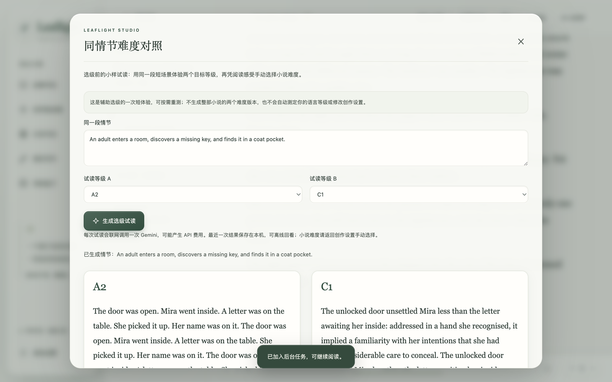
      <p align="center"><sub><b>同情节难度对照界面</b>：截图使用自动测试的模拟响应，仅展示布局与交互；其中重复文本不是实际 Gemini 生成效果，也不是内置的离线对照材料。</sub></p>
    </td>
  </tr>
</table>

---

### 2. 拟真翻页阅读器与 10 套全局材质主题

- **8 种拟真翻页动效**：支持 `Paper Curl（仿真卷页）`、`Cube In（内立方翻转）`、`Cube Out（外立方翻转）`、`Carousel（旋转木马）`、`Flip（中轴对折）`、`Bounce（弹性回跃）`、`Slide（平滑推页）` 与 `Fade（呼吸淡入）`。分页模式下，在正文上左右滑动、按住拖动或用触控板双指横滑会翻一页并播放当前动效；底栏按钮和方向键仍然可用。滑动过程中正文不再跟着滑走。系统开启减少动态效果时，仍会翻页，但不再播放动效。
- **自适应阅读与全窗口**：支持滚动与分页模式、字号、行距和正文宽度设置。点击「放大阅读区」「放大写作区」或「放大评审区」后，侧栏、页面顶栏和系统菜单栏全部让开，当前区域铺满窗口。横屏和竖屏都不常驻按钮；轻点页面后，右上角短暂出现「消息」和「退出」。Esc 先关闭弹窗和消息盒子，再退出全窗口，并保留当前阅读文字位置。网页预览会尽量进入浏览器全屏；若浏览器拒绝，阅读区仍然铺满页面。
- **日语振假名注音（Furigana）**：针对 JLPT `N5–N3` 章节自动渲染标准 `<ruby>漢字<rt>かんじ</rt></ruby>` 假名注音，并在正文下方提炼核心语法句型。
- **书签可添加也可取消**：书签按钮为开／关状态；目录中每条书签右侧「×」可直接删除，兼容旧记录和同页重复书签。

<div align="center">
  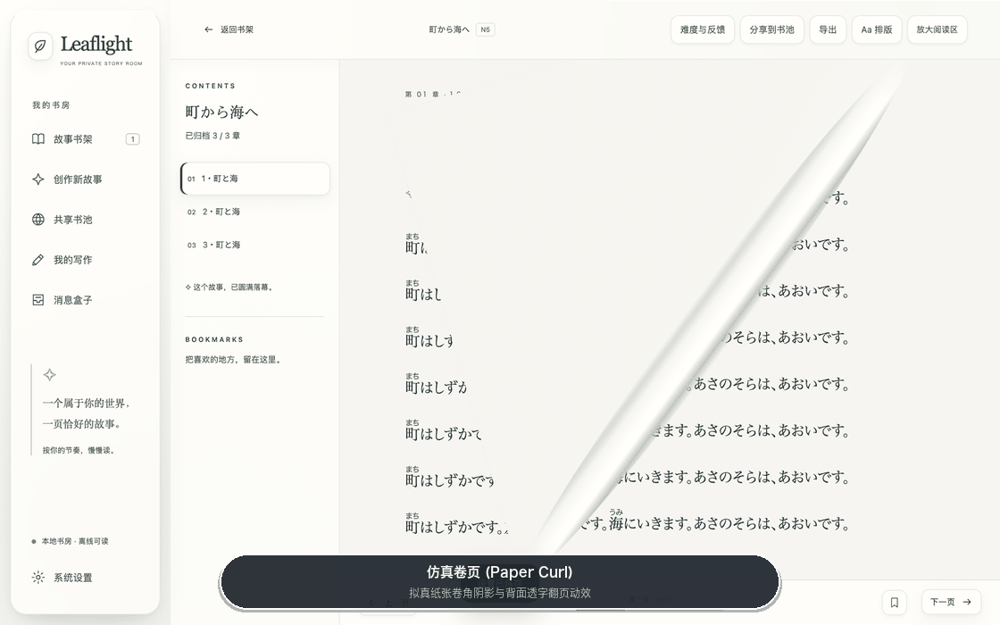
  <p align="center"><sub>▲ <b>8 种仿真翻页动效 & 10 套全局材质主题</b>（Paper / Rose / Mist / Sand / Bamboo 纸感 + Ocean / Violet / Dusk / Jade / Night 玻璃拟态）</sub></p>
</div>

<table>
  <tr>
    <td width="50%">
      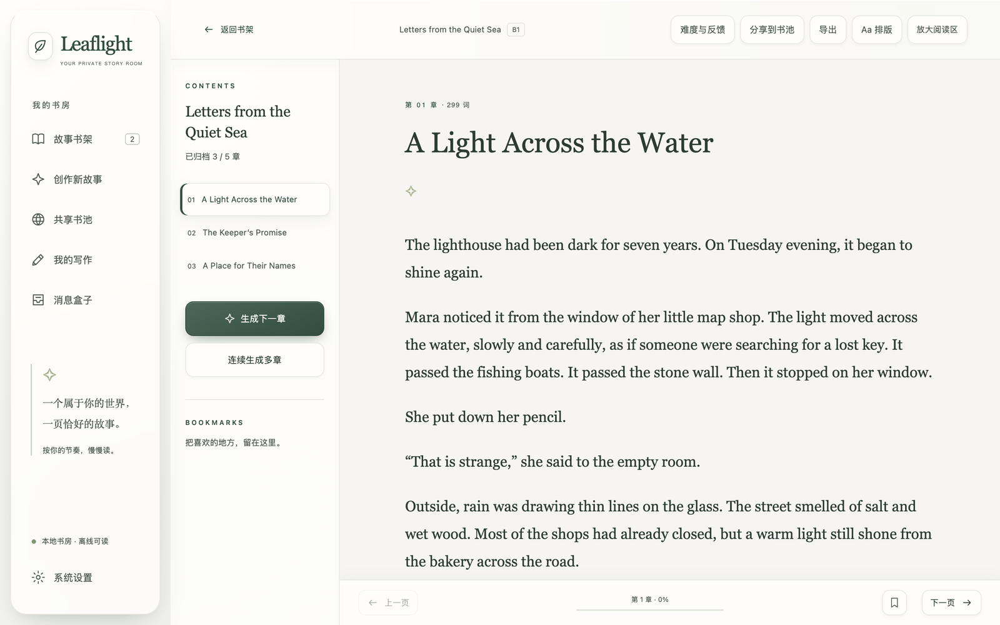
      <p align="center"><sub><b>英语沉浸式阅读器</b>：目录抽屉、字号/行距调节与页码进度</sub></p>
    </td>
    <td width="50%">
      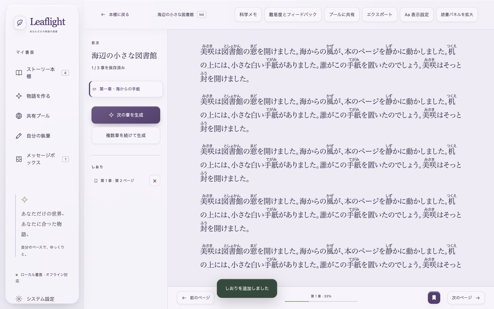
      <p align="center"><sub><b>日语阅读与三语 UI</b>：支持 N5–N3 汉字振假名与语法要点解析</sub></p>
    </td>
  </tr>
  <tr>
    <td width="50%">
      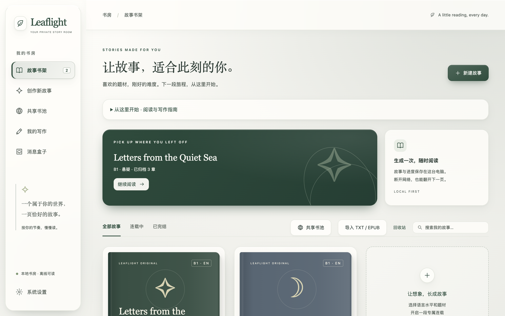
      <p align="center"><sub><b>暖纸护眼主题（Warm Paper）</b>：温润纸张肌理，适合长时阅读</sub></p>
    </td>
    <td width="50%">
      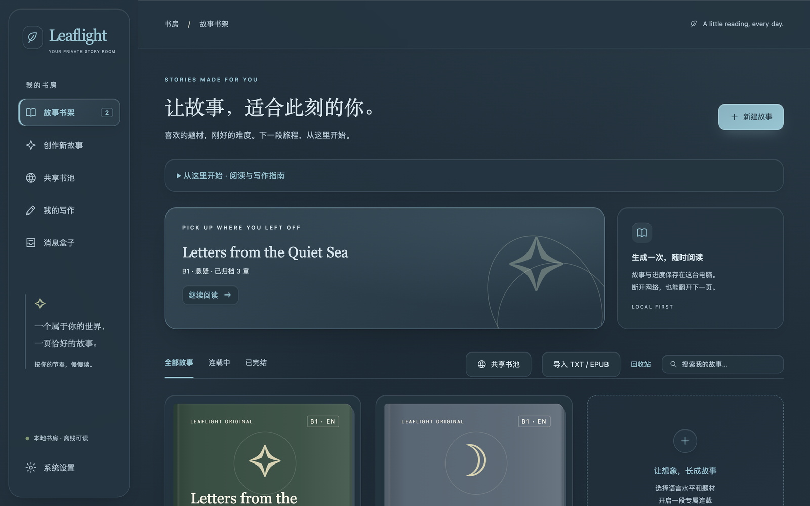
      <p align="center"><sub><b>深海冷光主题（Ocean Glass）</b>：高对比毛玻璃拟态，支持透光度调节</sub></p>
    </td>
  </tr>
</table>

---

### 3. 科学 × 奇幻主线融合与本地「科学手记」

Leaflight 独创了 **Science × Fantasy（科学 × 奇幻/科幻/悬疑）** 伴学模式，拒绝生硬说教，让科学原理成为主角破局的钥匙：

- **24 个跨学段真实科学单元**：覆盖 **小学（Primary）→ 初中（Middle）→ 高中（High）→ 大学通识（University）** 四大阶段，涵盖物理与工程、生物与医学、化学与材料、地球与空间四大领域。
- **48 个双语科学故事预设**：例如在《雾港钟楼的回声》中利用「声波反射与介质传播」破解密室回声，或在《深海发光实验室》中借助「生物荧光与酶催化」追踪失落样本。
- **本地「科学手记（Science Notebook）」**：核心原理、常见误区、自测与来源链接由本地结构化资料渲染，参考 [England National Curriculum DfE](https://www.gov.uk/government/collections/national-curriculum)、[日本文部科学省 MEXT 学習指導要領](https://www.mext.go.jp/a_menu/shotou/new-cs/index.htm)、[NASA Science](https://science.nasa.gov/)。它与模型生成的故事正文分开；资料与 AI 文本仍应结合来源核对。

<table>
  <tr>
    <td width="50%">
      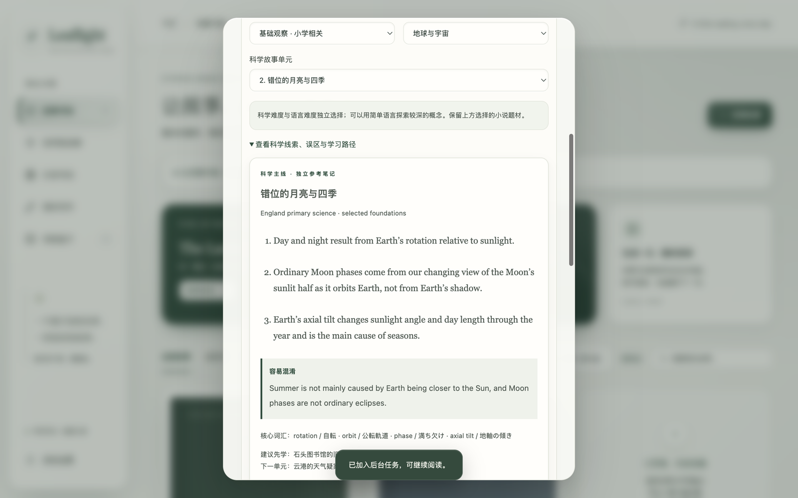
      <p align="center"><sub><b>科学 × 奇幻故事预设</b>：按学段与学科挑选感兴趣的科学解谜主线</sub></p>
    </td>
    <td width="50%">
      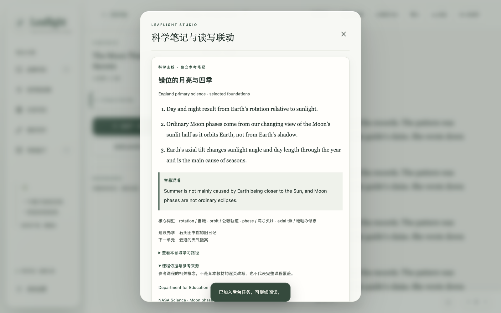
      <p align="center"><sub><b>章节「科学手记」</b>：原理拆解、误区纠偏与英/日/美官方课程权威来源</sub></p>
    </td>
  </tr>
</table>

---

### 4. 独立写作台与四维 AI 写作教练（184 道内置题库）

无需先读完小说，随时可进入左侧导航的 **「我的写作」** 开启针对性训练；也可以在读完任意故事章节后一键进入 **「读后感 / 故事续写 / 科学观察手记」**。

- **184 道原创练习题**（参考题型与课程主题，不是官方考题或教材摘录）：
  - **雅思题型训练（IELTS Academic Task 1 & Task 2）**：Task 1 内置**真实可视化柱状图、数据表与流程图组件**，完整还原图表作文审题场景；
  - **日本留学试验（EJU 日本語記述問題）**：贴合日本大学入试学术议论文要求；
  - **小学 → 初中 → 高中 → 大学进阶训练**：覆盖记叙、书信、议论与学术思辨；
  - **96 道科学写作专项任务**：围绕物理、化学、生物、地球与宇宙的 24 个知识单元，各提供概念解释和证据推理练习；题目提供参考知识、常见误区与思考提示，不要求虚构情节。历史草稿保留其原题。
- **四维 AI 批改与原文精确摘录验证**：
  - 从 **语法与拼写、词汇与用词、逻辑与衔接、通顺与表达** 四个维度提供定性反馈；有题目时另评任务回应，科学题另附概念反馈；
  - 逐句建议的原文摘录通过本地子串校验，不匹配的评审会报错；AI 判断和修改建议仍可能有误；
  - 「查看提交时的原文」和「查看完整修订参考稿」支持整行点击及 Enter／空格展开。编辑区与评审区可分别放大，草稿及评审展开状态保留；
  - 草稿自动保存在本机；删除会经确认永久移除正文、评审与相关任务，需保留的稿件可归档或先导出。

<table>
  <tr>
    <td width="50%">
      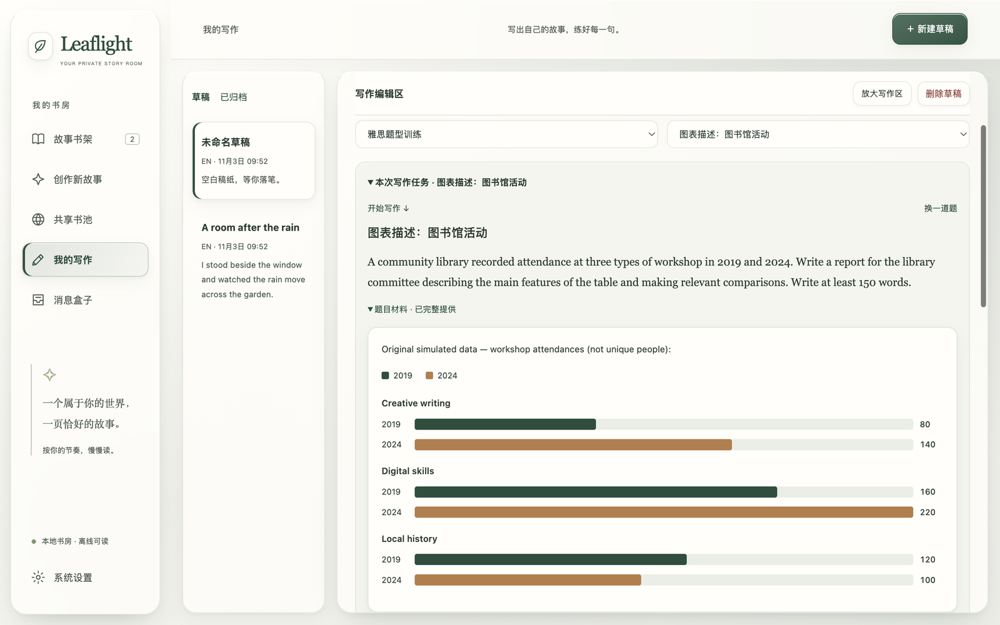
      <p align="center"><sub><b>IELTS 图表作文真实渲染</b>：内置可视化柱状图与流程材料，告别干瘪纯文本题干</sub></p>
    </td>
    <td width="50%">
      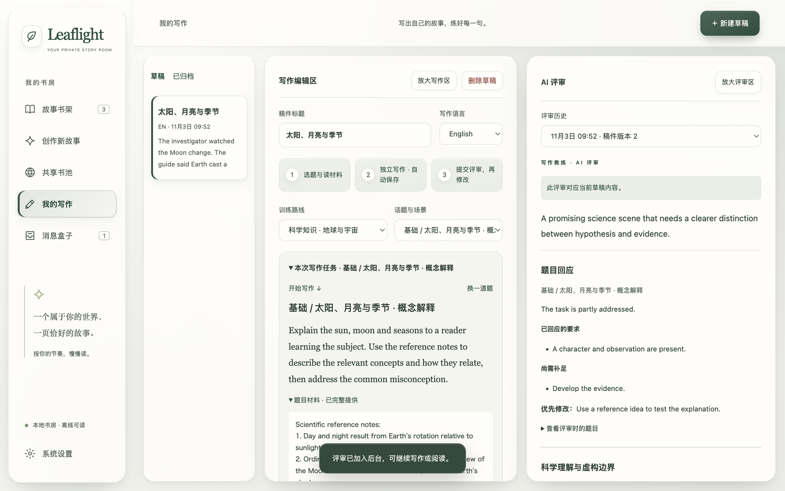
      <p align="center"><sub><b>AI 写作教练</b>：四维语言反馈、任务回应与科学概念反馈，以及原文对照润色</sub></p>
    </td>
  </tr>
</table>

---

### 5. 本地优先、共享书池（免 Key 读与分享）与非阻塞后台消息盒子

- **共享书池（从公共书池拉取 / 上传到公共书池）**：
  - **免 API Key 借阅与按需下载**：点击「共享书池」按英／日语言和等级筛选，展开开篇试读。内置 4 部完整作品可离线使用；「从 GitHub 同步最新」仅拉取目录、简介和试读，点击「加入书架」才下载并校验该小说全文，之后离线阅读。
  - **长篇分享包投稿**：在书架卡片或阅读器点击「分享 → 分享包投稿」，保存 ZIP，在自动打开的 GitHub 投稿页上传附件，等待上传完成再提交。无需 Gemini Key 或 GitHub Token；不再把整本小说粘贴进 Issue 正文。收录成功／失败由机器人回复在原投稿下，保存分享包不等于已投稿或已收录。
  - **兼容与隐私**：剥离个人进度、书签、密钥与本地任务；旧单书 JSON 和正文投稿继续兼容，Mac 与 Android 均支持导入 ZIP。分享包 ZIP 上限 25 MiB、解压 JSON 上限 30 MiB、最多 100 章；正文中自行写入的私人信息需投稿前检查。Mac 的 Token 直传保留给短篇。[操作、上限及收录说明](docs/community-pool.md)。
- **非阻塞后台任务队列（消息盒子）**：新建故事、续写章节或提交长文批改时，任务进入后台运行。你可以继续阅读其他作品，在「消息盒子」查看进度和结果。
- **连续生成多章（Mac / Android）**：打开作品，在章节目录下点击「连续生成多章」，选择章数后开始；可选剩余全部章节。章节按顺序生成，每章保存后即可阅读，下一章会使用最新的故事摘要和连续性记忆。每章发起一次 API 调用；这能减少重复操作，单章生成速度仍取决于模型。失败或停止时保留已完成章节，在消息盒子点击「继续未完成章节」仅补齐原定范围内的剩余章节；退出应用后不会自动恢复付费生成。停止后不再发起后续请求，已发出的请求仍可能计费。
- **修改要求，重新试读**：在初次试读页点击此按钮，会返回并保留最初填写的创作要求。修改后重新生成的是一份新的试读和大纲；这里不编辑或微调上次 AI 生成的大纲。设定说明和费用细节按需展开，常用操作优先呈现。
- **离线示例**：无需 API Key 即可打开内置的三章英文故事 *The Lantern Keeper*，体验排版、翻页和书签，也可离线浏览写作题库；它是固定示例，不是按自定义提示生成的作品。
- **支持导出与备份**：支持将任意完结或连载中的故事导出为标准 **EPUB 3 电子书**（兼容 Apple Books / Kindle / Kobo）或 **TXT 纯文本**，并支持全库 JSON 一键备份与恢复。

<table>
  <tr>
    <td width="50%">
      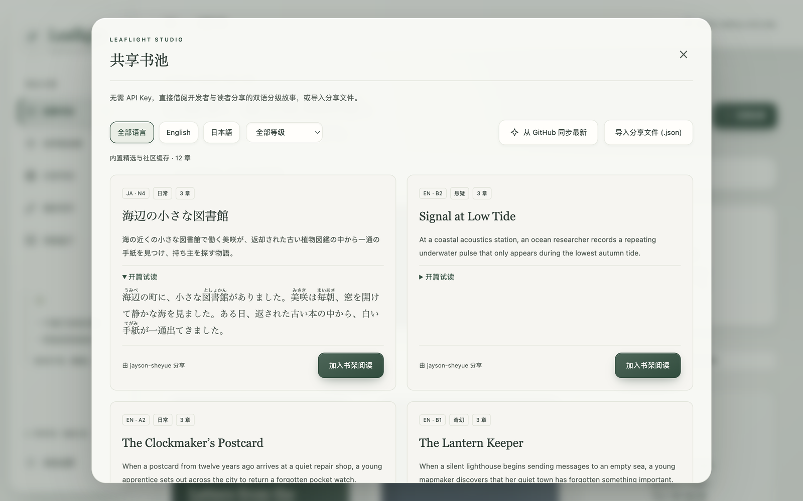
      <p align="center"><sub><b>共享书池（免 Key 借阅）</b>：按语言/等级筛选，展开开篇试读（含日语振假名）并一键加入书架</sub></p>
    </td>
    <td width="50%">
      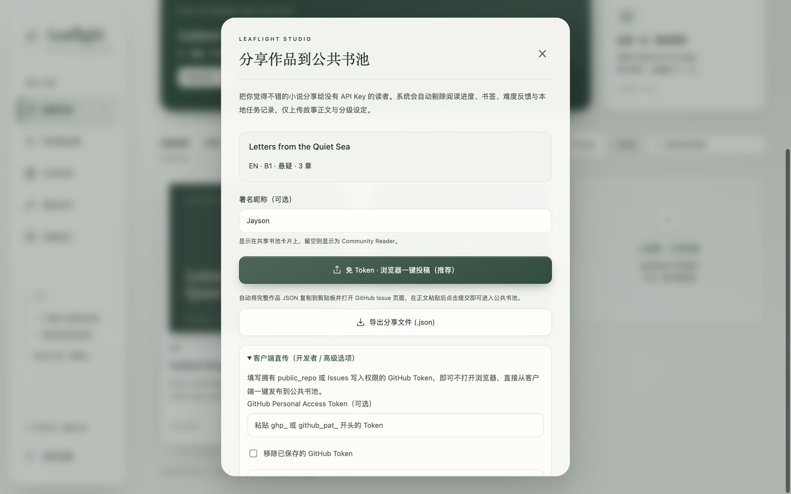
      <p align="center"><sub><b>一键脱敏分享</b>：演示数据：保存 ZIP 后上传投稿，短篇 Token 直传与 JSON 导出保留</sub></p>
    </td>
  </tr>
</table>

<div align="center">
  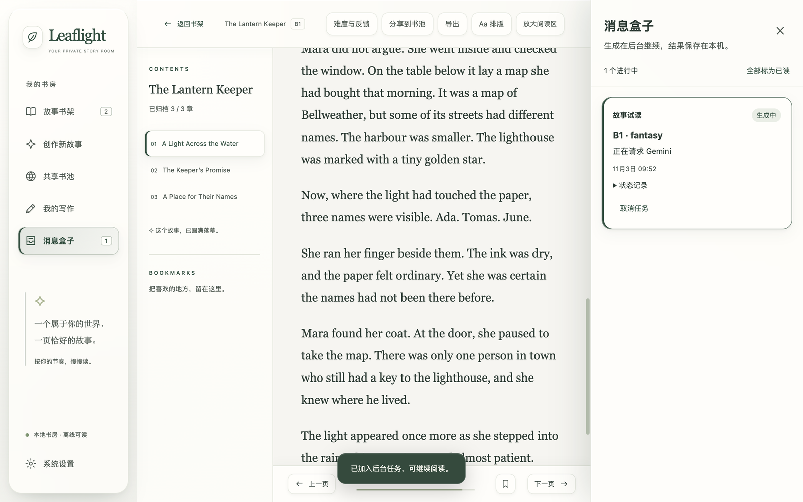
  <p align="center"><sub>▲ <b>非阻塞后台任务队列（消息盒子）</b>：AI 生成章节与批改在后台静默完成，等待生成时仍可阅读和写作</sub></p>
</div>

---

## 📦 下载安装与快速上手

### 🌐 在线网页预览版（GitHub Pages · 免下载 · 免 API Key · 手机/电脑即点即读）

如果你想先免安装体验 Leaflight 的拟真电子书排版、10 套纸感与毛玻璃主题、8 种 3D 翻页动效以及共享书池佳作，可直接浏览器打开：

👉 **[https://jayson-sheyue.github.io/Leaflight/](https://jayson-sheyue.github.io/Leaflight/)**

- **默认书架开箱即读（预置 6 部英日分级小说）**：
  1. **《The Magic Rebellion of Oak High》**（英语 `CEFR B1` · 奇幻 · **8 章完整连载**）
  2. **《海辺の小さな図書館》**（日语 `JLPT N4` · 日常 · 3 章完结 · **内置 `<ruby>` 汉字振假名注音与语法要点**）
  3. **《The Spear and the Cipher》**（英语 `CEFR B2` · 科幻 · 3 章连载）
  4. **《The Lantern Keeper》**（英语 `CEFR B1` · 奇幻 · 3 章完结）
  5. **《The Clockmaker's Postcard》**（英语 `CEFR A2` · 悬疑 · 2 章完结）
  6. **《Signal at Low Tide》**（英语 `CEFR B2` · 科幻 · 2 章完结）
- **网页预览版支持功能**：完整的书架与阅读器（字号、行距、分页/滚动、放大阅读区、书签、读后难度体感反馈、单章启发式难度分析）、10 套材质主题与 8 种翻页动效、中/日/英三语界面、从 GitHub 实时同步公共书池并加入书架、浏览 24 个科学单元/48 个科学×奇幻预设与 184 道写作题库（阅读进度与草稿保存在当前浏览器 `localStorage`）。
- **与原生客户端的区别**：在线网页预览版为纯静态零后端部署（不含服务端 API 中转）；如需使用 **本地存储 + 系统凭据加密**、**BYOK 自定义 Gemini API Key 后台连载生成**、**四维 AI 写作批改** 或 **本地 TXT/EPUB 导入导出**，请使用 macOS / Windows 桌面端或 Android 阅读器。写作批改只在桌面端。iPhone / iPad 请使用上方网页预览。

### 当前版本

Mac 安装包是 v0.12.2，包含全窗口阅读／写作，并保留 ad-hoc 签名，尚未获得 Apple 公证。同一 Release 还附有未签名的 Windows x64 安装包。分页模式下，滑动、拖动或触控板双指横滑正文会翻一页并播放所选动效。这两个安装包放大后都不常驻按钮；横屏和竖屏都只在轻点页面后，于右上角短暂显示「消息」和「退出」。网页预览同样如此。Android Reader 是 0.3.0-preview.7，阅读页可以进入全屏：隐藏页眉、底栏、状态栏和导航栏，正文上不常驻按钮。轻点页面后，右上角会短暂出现「消息」和「退出」。网页预览在横屏和竖屏也使用同样的短暂文字，不再放常驻按钮。不再提供 iOS 安装包。各端都支持 AI Studio／Vertex Express 密钥来源选择。更新都是手动替换。详见 [v0.12.2 说明](docs/releases/v0.12.2.md)、[Android 0.3.0-preview.7 说明](docs/releases/android-v0.3.0-preview.7.md) 与 [共享书池指南](docs/community-pool.md)。

已用 24 章、约 20 万字符的合成作品完成真实 GitHub ZIP 投稿、自动收录反馈及 Android 最终 APK 全文借阅验收；测试条目已清理。[公开验收记录](https://github.com/jayson-sheyue/Leaflight/issues/2)。

### Android Pad 阅读预览

独立的 **Leaflight Reader 0.3.0-preview.7** 安卓项目支持导入 Mac JSON 离线阅读，提供主题、字体、翻页、书签与进度，并同步支持「共享书池」免 Key 借阅、目录同步、按需下载与 ZIP / 单书 JSON 分享。阅读中可点「全屏阅读」：正文铺满屏幕，系统状态栏和导航栏一并隐藏，页面上不放常驻按钮。轻点正文，右上角短暂出现「消息」和「退出」；系统返回键会先退出全屏。可导入 UTF-8 TXT、未加密 EPUB、单书分享 JSON 或全库备份；也可配置自己的 Gemini Key，生成英日独立短篇或先试读后创建章节连载；支持下一章、连续多章、逐章保存、停止及手动补齐剩余章节，状态在消息盒子中查看。试读的「修改要求，重新试读」会修改原始创作要求并生成新试读与大纲。两端进度暂不自动同步；安卓版暂不包含写作、评审与选级对照等既有模块。Mac 与 Android 的构建和数据独立。[安装、构建与限制说明](android-reader/README.md)。 [下载 APK](https://github.com/jayson-sheyue/Leaflight/releases/tag/android-v0.3.0-preview.7)。

### 方式一：直接安装 macOS 桌面端（推荐）

1. 前往本仓库的 [**v0.12.2 Release**](https://github.com/jayson-sheyue/Leaflight/releases/tag/v0.12.2)，下载安装包：
   - 🍎 **`Leaflight-0.12.2-arm64.dmg`**（Apple Silicon Mac，含全窗口阅读／写作。放大后不常驻按钮。分页下可拖动或双指横滑翻页。不提供 Intel / Linux 安装包。）
2. 双击打开 `.dmg`，将 **Leaflight.app** 拖入 `Applications（应用程序）` 文件夹。
3. 首次打开即可在「共享书池」免费借阅英日分级小说、阅读内置示范故事、导入本地 `TXT / EPUB` 电子书，或浏览 184 道写作题库；如需使用 **AI 生成新故事/章节** 或 **AI 写作批改**，请按下方指南填入你自己的 Gemini API Key。

> **安装限制**：v0.12.2 沿用 ad-hoc 整包签名，没有 Developer ID 和 Apple 公证，macOS 默认仍可能阻止打开。严格签名校验通过不等于 Gatekeeper 放行。确认下载来源后，请参照 [macOS 安装与报错说明](docs/macos-installation.md) 及 Apple 官方的单应用允许方式；当前不能承诺所有 Mac 默认双击打开。

**手动更新**：先在系统设置导出全库备份，等待后台任务完成并退出应用，再下载新版安装包，将应用替换到原安装位置。不要删除 `~/Library/Application Support/novel-reading/`（Windows 为 `%APPDATA%\novel-reading`）用户数据目录。当前没有应用内检查更新或自动安装功能。

### Windows 桌面端（x64）

从 [v0.12.2 Release](https://github.com/jayson-sheyue/Leaflight/releases/tag/v0.12.2) 下载 `Leaflight-0.12.2-win-x64-setup.exe`。这是 64 位、未签名的 NSIS 安装程序，可以选择安装目录，默认安装到当前用户。Windows 可能拦截未签名安装包；不要为此关闭系统保护。作品、写作草稿和进度保存在 `%APPDATA%\novel-reading`，与 Mac 一样可以导出不含 API Key 的全库备份。写作批改和全窗口与 Mac 相同，放大后不常驻按钮。这个文件由 GitHub Actions 的 Windows 运行器构建，没有在 Windows 上启动过。[安装说明](docs/windows-installation.md)。

### iPhone / iPad

请直接打开 [网页预览](https://jayson-sheyue.github.io/Leaflight/)。不再提供 iOS 安装包。横屏和竖屏放大阅读区后，页面上不常驻按钮。轻点正文，右上角会短暂出现「消息」和「退出」。浏览器能响应 Esc 时，可用 Esc 退出全窗口。阅读数据保存在当前浏览器中，容量小于 Mac、Windows 和 Android 应用。

---

### 🔑 如何获取与配置 Gemini API Key（1 分钟新手指南）

Leaflight 不内置第三方付费中转，而是由你配置自己的 Google 官方密钥直连调用：

- **无需 API Key 即可使用的功能**：在 **「共享书池」** 免费借阅或从 GitHub 同步开发者与社区读者分享的英日分级小说、阅读内置英文示范故事 *The Lantern Keeper*、导入本地 `TXT / EPUB / JSON` 书籍享受 10 套纸感主题与 8 种翻页动效、离线浏览 184 道分级写作题库并保存草稿。
- **需要 API Key 的功能**：在「AI 创作室 / 科学工坊」定制生成英日外语故事与连载章节，以及在「写作工坊」提交作文获取 AI 批改与高分范文。

#### 获取与填入步骤

1. **前往 Google 官方平台申请密钥**：
   浏览器打开 [**Google AI Studio — Get API key (`https://aistudio.google.com/apikey`)**](https://aistudio.google.com/apikey)，使用你的 Google 账号登录。
2. **创建并复制 API Key**：
   点击页面右上角的 **`Create API key`**（创建 API 密钥），生成 API Key（可能是旧式 `AIza…` 或新式授权密钥），点击复制。
3. **在 Leaflight 中保存配置**：
   - **macOS 桌面端**：点击左下角 **「系统设置 / 模型与设置」** → 将 **Gemini 服务来源** 选为 **Google AI Studio**，在 **Gemini API Key** 栏粘贴刚才复制的密钥；**Gemini 模型 ID** 保持默认的 `gemini-2.5-flash` 即可（也可按需修改为 `gemini-2.5-pro` 等支持 `generateContent` 与 JSON 结构化输出的官方模型）→ 点击 **「保存设置」**（已保存的 Key 会以圆点显示）。
   - **Android 阅读预览版**：点击 **「生成故事 → Gemini 设置」** → 选择密钥创建来源、粘贴 API Key 并保存。

> **Vertex Express**：若 Key 来自 Google Cloud 的 Vertex Express，在两端设置中选择 **Vertex AI Express**。不要仅凭 `AQ.` 前缀判断来源；旧设置默认继续使用 AI Studio。模型权限和额度独立，服务失败不会切换到另一平台重试。

> **配置、隐私与费用说明**：
> - **免费额度与计费**：Google AI Studio 通常为 `gemini-2.5-flash` 等模型提供免费调用额度（Free Tier），具体免费额度、速率限制及是否产生费用取决于你的 Google 账户状态、所在地区政策及所选模型。
> - **本地加密存储**：你的 API Key 通过 macOS 系统 Keychain（Electron `safeStorage`）或 Android Keystore 加密保存在本机，仅在请求时直连 Google 官方接口，不会上传至任何第三方服务器，也不会包含在导出的 JSON 备份中。接口与数据发送范围详见 [API 集成说明](docs/api-references.md)。

---

### 方式二：从源码本地运行与构建

#### 环境要求
- **操作系统**：已在本机 Apple Silicon macOS 验证；包内最低系统声明为 macOS 12.0，最低版本系统尚未实机验证。
- **Node.js**：建议 `22.12+`，使用 `npm ci` 安装锁定依赖；运行打包应用无需另装 Node。

#### 启动开发环境
```bash
# 1. 克隆仓库
git clone https://github.com/jayson-sheyue/Leaflight.git
cd Leaflight

# 2. 安装依赖
npm ci

# 3. 启动桌面端热重载开发模式
npm run dev
```

#### 常用脚本与打包指令
```bash
# 类型检查与前端构建
npm run build

# 生成 macOS .app 与 .dmg 安装包（输出至 release/ 目录）
npm run package:dmg

# 生成 Windows x64 NSIS 安装包
npm run package:win

# 单元测试与 15 项 Electron 桌面测试（使用隔离数据与受控模型响应）
npm test
npm run test:desktop
```

---

## 🏗️ 技术架构与工程设计

Leaflight 采用严格的进程隔离与本地优先架构，确保桌面端轻量、安全且易维护：

```text
Leaflight/
├── electron/
│   ├── main.cjs                # Electron 主进程：窗口生命周期、Keychain (safeStorage) 加密与安全 IPC 注册
│   ├── preload.cjs             # ContextBridge 白名单桥接（禁用 nodeIntegration）
│   ├── store.cjs               # 本地持久化存储、Schema 迁移、阅读锚点与回收站/JSON 备份
│   ├── gemini.cjs              # Gemini 原生 responseSchema 结构化输出 + 启发式难度复核与科学手记合并
│   ├── jobs.cjs                # 非阻塞后台任务队列（消息盒子）调度引擎
│   ├── science.cjs             # 24 个科学单元、48 个科学×奇幻预设与本地参考资料加载器
│   ├── writing.cjs             # 四维 AI 写作批改与原文精确摘录 (originalQuote) 校验
│   ├── writing-topics.cjs      # 184 道英日分级写作题库与 96 道科学写作专项任务引擎
│   ├── difficulty.cjs          # 英日分级约束（CEFR A2–C1 / JLPT N5–N1）与启发式复杂度检测
│   ├── pool.cjs                # 共享书池：作品脱敏打包、GitHub 索引/Issue 同步与客户端直传引擎
│   ├── pool-seed.json          # 内置双语分级种子小说（含日语 N4 振假名注音）
│   └── export.cjs              # 标准 EPUB 3 与 TXT 电子书打包导出器
├── community-pool/             # GitHub 公共书池索引 (index.json) 与自动归档的共享小说 JSON
├── src/
│   ├── main.ts                 # 应用主视图状态机、阅读器、创作工坊与后台消息盒子交互
│   ├── web-bridge.ts           # 纯静态 Web 预览适配层：浏览器 localStorage 持久化、默认预置共享书池书架与桌面端零侵入降级
│   ├── writing.ts              # 独立写作台、IELTS 可视化图表渲染与四维批改报告视图
│   ├── science.ts              # 科学×奇幻预设选择与章节「科学手记」抽屉组件
│   ├── materials.ts            # 10 套全局材质与毛玻璃主题、12 套字体栈控制器
│   ├── page-transitions.ts     # 8 种拟真 3D 翻页动效控制器与章节边界锚点保护
│   ├── panel-focus.ts          # 阅读/编辑/评审全窗口，隐藏菜单栏并保留正文与编辑器
│   └── i18n.ts                 # 简体中文 / 日本語 / English 完整界面国际化字典
├── scripts/
│   └── create-dmg.cjs          # macOS Apple Silicon (.app & .dmg) 自动化打包脚本
└── tests/                      # Node.js 单元测试 + Playwright Electron 真实桌面端 E2E 测试套件
```

### 核心工程保障
1. **结构化输出与本地校验**：调用 Gemini 官方 `v1beta` REST `generateContent`，设置 JSON MIME 和 `responseSchema`，再校验规划、章节与评审字段；结构化约束不保证内容确定或事实正确。
2. **可读性检查**：测试覆盖 10 套主题的已渲染文字，受测状态达到对比度 `≥ 4.5:1`；这不是对全部 WCAG 条款的合规认证。
3. **桌面回归测试**：覆盖分级规则、题库、阅读与写作交互、后台任务、书签、面板放大及布局连续性；模拟模型响应不能代替真实服务联调。

---

## 📋 版本演进摘要（Changelog）

- **`v0.12.2`（当前 Mac / Windows 版本）**：分页模式下，按住拖动或触控板双指横滑正文会翻一页并播放所选动效，正文不再跟着滑走。安装包为 `Leaflight-0.12.2-arm64.dmg` 与 `Leaflight-0.12.2-win-x64-setup.exe`。[说明](docs/releases/v0.12.2.md)。
- **`v0.12.1`**：已发布的 Mac DMG 和 Windows 安装包去掉放大后的常驻按钮。轻点页面后，右上角短暂显示「消息」和「退出」。安装包为 `Leaflight-0.12.1-arm64.dmg` 与 `Leaflight-0.12.1-win-x64-setup.exe`。[说明](docs/releases/v0.12.1.md)。
- **`v0.12.0`**：阅读、写作和评审可以铺满整个窗口，并隐藏侧栏、顶栏和系统菜单栏。这一版已发布的安装包仍会留下两个常驻按钮，请改用 v0.12.1。iPhone / iPad 使用网页预览，不再提供 iOS 安装包。[说明](docs/releases/v0.12.0.md)。
- **`v0.11.16`**：Mac / Android 本地长篇导入扩展至 5000 章，兼容普通 EPUB 文档声明，补齐重启、书签、备份与明确错误提示。[说明](docs/releases/v0.11.16.md)。
- **`v0.11.15`**：同步 Gemini 密钥来源选择、Express 固定端点和任务配置快照。[说明](docs/releases/v0.11.15.md)。
- **`v0.11.13`**：修复 macOS App 资源签名，仍未公证。[说明](docs/releases/v0.11.13.md)。
- **`v0.11.12`**：Mac 与 Android 同步新增共享书池、免 Key 借阅与脱敏分享；此版 Mac 签名存在已知问题，请改用新版。[历史说明](docs/releases/v0.11.12.md)。
- **`v0.11.11`**：新增逐章保存的连续生成，支持停止与手动续接；澄清修改原始要求后重新试读的流程，收起低频说明。[完整发布说明](docs/releases/v0.11.11.md)。
- **`v0.11.10`**：明确难度对照的选级试读用途，界面、说明与演示截图标注保持一致。[完整发布说明](docs/releases/v0.11.10.md)。
- **`v0.11.9`**：独立表达润色、184 道英日写作练习、客观科学写作、自备题目与 TXT/EPUB 导入；Android 预览版独立发布。[完整发布说明](docs/releases/v0.11.9.md)。
- **`v0.11.6`**：阅读、编辑和 AI 评审支持放大，辅助面板自动收起；恢复布局、翻页和重新打开作品时保留阅读文字位置。消息盒子以覆盖层展开，Esc 优先关闭弹窗或消息盒子。包含 v0.11.5 本地修复：评审原文／修订稿整行与键盘展开，旧书签及同页重复书签可取消，书签列表支持直接删除。[完整发布说明](docs/releases/v0.11.6.md)。
- **`v0.11.5`（仅本地开发构建）**：评审展开与书签取消修复，随 v0.11.6 一并发布。
- **`v0.11.4`（首个 GitHub Release）**：包含科学 × 奇幻阅读预设、本地科学手记、科学写作任务及概念反馈。
- **`v0.11.3`**：新增 **非阻塞后台任务队列（消息盒子）**、IELTS 图表题真实可视化渲染、同剧情跨级难度对比预览与读后难度体感校准。
- **`v0.11.1` – `v0.11.2`**：重构 **10 套全局材质与毛玻璃主题系统**、**8 种翻页动效**、**12 套字体栈** 与 **中/日/英三语 UI**，加入文字对比度检查。
- **`v0.10.0`**：新增 **日语分级阅读与写作支持（JLPT N5–N1）**、汉字 `<ruby>` 振假名注音与 EJU 日本留学试验写作训练。
- **`v0.1.0` – `v0.9.0`**：完成本地 SQLite + Keychain 基础架构、英语 CEFR A2–C1 多章连载记忆引擎、独立写作台与 EPUB 3 导出。

---

## 📄 开源协议 (License)

本项目基于 [MIT License](LICENSE) 开源。欢迎 Star ⭐、Fork 或提交 Issue 与 Pull Request！

### 单篇文件与完整备份

在 Mac 书架选择「导入 TXT / EPUB」，或在 Android 书架选择「导入 TXT / EPUB / 备份」。支持 UTF-8 TXT 与未加密的常见 EPUB：本地作品最多 5000 章／分段，单文件 50 MiB、正文 3200 万字符；EPUB 总展开量 128 MiB、文字资源 64 MiB、最多 20000 个文件条目。兼容普通 HTML／XHTML 文档声明，较长单章会按段落拆为阅读分段，原文顺序保留；TXT 会按正文导入，EPUB 会读取文字章节和日语注音，原排版、图片、字体和部分复杂结构不保证保留。导入产生新副本，不会覆盖原书；难度不作判定。单篇 TXT/EPUB 不含书签、进度、草稿、AI 评审与生成设定，完整迁移仍请使用 JSON 备份（128 MiB 上限）。AI 连载生成与共享书池仍分别保持最多 100 章的边界。[长篇导入说明](docs/long-book-import.md)。

题库的 184 道题均为原创训练材料，不是剑桥真题或教材原文；可在写作台的「自备题目或写作目标」中输入已有题目，自由写作时用于 AI 评审参考。IELTS 官方另提供[公开样题](https://ielts.org/take-a-test/preparation-resources/sample-test-questions/academic-test)。
